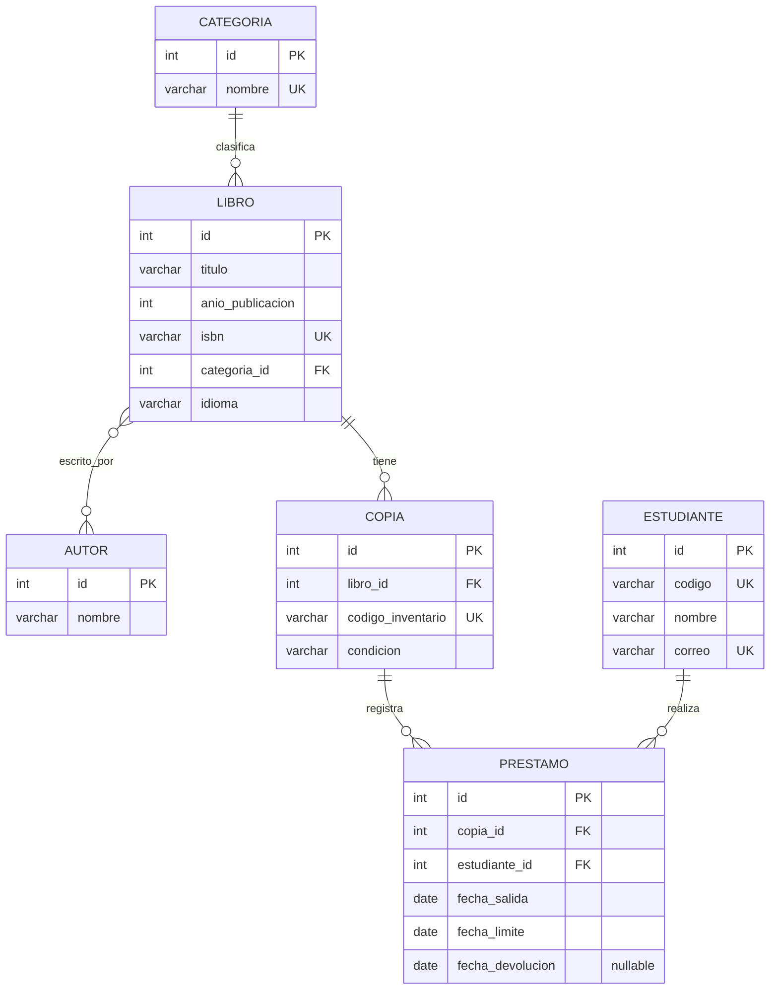

# biblioteca-ufps


## FASE 5. Consultas del ORM

Todas las consultas se ejecutaron en el shell de Django (`python manage.py shell`) con los datos de prueba cargados (`python manage.py loaddata datos_prueba.json`). Al abrir el shell se escribió:

---

### Reto 1. Crear un autor, un libro y dos copias

```python
Autor.objects.create(nombre="Stephen King")
Libro.objects.create(titulo="It", anio_publicacion=1986, isbn="9788466357302", categoria="Terror", autores="Stephen King", idioma="Español")
libro = Libro.objects.get(titulo="It")
libro.autores.add(Autor.objects.get(nombre="Stephen King"))
Copia.objects.create(libro=libro, codigo_inventario="INV-100")
Copia.objects.create(libro=libro, codigo_inventario="INV-101")
```

**Predicción:**

```
<Autor: Stephen King>
<Libro: It (1986)>
<Copia: INV-100 - It>
<Copia: INV-101 - It>
```

**Resultado:**

```
<Autor: Stephen King>
ValueError: Cannot assign "'Terror'": "Libro.categoria" must be a "Categoria" instance.
TypeError: Direct assignment to the forward side of a many-to-many set is prohibited. Use autores.set() instead.
```

**Explicación y ajuste:** Crear el autor funcionó. El primer error vino de pasar el texto `"Terror"` en `categoria`: una `ForeignKey` pide un objeto `Categoria`, así que hay que obtenerlo (o crearlo) antes. El segundo error es porque `autores` es un `ManyToManyField` y no se puede asignar dentro de `create()`: el libro debe existir primero y los autores se agregan después con `add()`. También es más cómodo guardar el autor y el libro en variables. El código correcto es:

```python
Categoria.objects.create(nombre="Terror")   # "Terror" no existía en los datos de prueba
autor = Autor.objects.create(nombre="Stephen King")
libro = Libro.objects.create(titulo="It", anio_publicacion=1986, isbn="9788466357302", categoria=Categoria.objects.get(nombre="Terror"), idioma="Español")
libro.autores.add(autor)
Copia.objects.create(libro=libro, codigo_inventario="INV-100")
Copia.objects.create(libro=libro, codigo_inventario="INV-101")
```

---

### Reto 2. Libros de un autor (buscando al autor por su nombre)

```python
Libro.objects.filter(autores__nombre="Gabriel García Márquez")
```

**Predicción:** Un QuerySet con los libros de Gabriel García Márquez.

**Resultado:**

```
<QuerySet [<Libro: Cien años de soledad (1967)>, <Libro: El amor en los tiempos del cólera (1985)>]>
```

---

### Reto 3. Libros cuyo título contiene una palabra, sin importar mayúsculas

```python
Libro.objects.filter(titulo_contains="amor")
```

**Predicción:** Un QuerySet con los libros que contienen la palabra "amor". En este caso solo hay uno, así que debería mostrar "El amor en los tiempos del cólera".

**Resultado:**

```
django.core.exceptions.FieldError: Cannot resolve keyword 'titulo_contains' into field. Choices are: anio_publicacion, autores, categoria, categoria_id, copia, id, idioma, isbn, titulo
```

**Explicación y ajuste:** Hubo dos errores de escritura. Primero, el separador entre el campo y el modificador es un doble guion bajo (`__`), no uno solo. Segundo, `contains` distingue mayúsculas de minúsculas; como el reto pide ignorarlas, se usa `icontains`. La forma correcta es:

```python
Libro.objects.filter(titulo__icontains="amor")
```

Resultado de la versión corregida:

```
(PEGAR AQUÍ lo que devolvió la versión corregida)
```

---

### Reto 4. Copias físicas disponibles (sin ningún préstamo activo)

```python
Copia.objects.exclude(prestamo__fecha_devolucion__isnull=True)
```

**Predicción:** Debería mostrar las copias sin préstamo activo, incluyendo las creadas en el reto 1.

**Resultado:**

```
<QuerySet [<Copia: INV-004 - Clean Code>, <Copia: INV-005 - El amor en los tiempos del cólera>]>
```

**Explicación y ajuste:** El comando dejó fuera las copias que nunca se han prestado. Al unir las tablas, para una copia sin préstamos la `fecha_devolucion` queda vacía, y Django la trata igual que un préstamo sin devolver, por eso `exclude` la elimina. Solo quedaron las copias que tienen préstamos y ya fueron devueltos. La forma correcta es buscar primero los préstamos activos y excluir las copias que aparecen en ellos:

```python
activos = Prestamo.objects.filter(fecha_devolucion__isnull=True)
Copia.objects.exclude(id__in=activos.values("copia"))
```

```
<QuerySet [<Copia: INV-004 - Clean Code>, <Copia: INV-005 - El amor en los tiempos del cólera>, <Copia: INV-006 - Domain-Driven Design>, <Copia: INV-007 - Domain-Driven Design>, <Copia: INV-008 - Sapiens>, <Copia: INV-100 - It>, <Copia: INV-101 - It>]>
```

---

### Reto 5. Estudiantes con al menos un préstamo activo, sin repetir

**Primer intento:**

```python
Estudiante.objects.filter(prestamo__fecha_devolucion__isnull=True).distinct()
```

**Predicción:** Debería mostrar a Valentina Rojas, Andrés Gómez y Laura Martínez, que son los estudiantes con al menos un préstamo sin devolver.

**Resultado:**

```
<QuerySet [<Estudiante: 1152001 - Laura Martínez>, <Estudiante: 1152003 - Valentina Rojas>, <Estudiante: 1152004 - Andrés Gómez>, <Estudiante: 1152005 - Sofía Ramírez>]>
```

**Explicación y ajuste:** Salió Sofía Ramírez, que nunca ha pedido un préstamo. Es el mismo problema del reto 4: para un estudiante sin préstamos, la `fecha_devolucion` de la unión de tablas queda vacía y la condición `isnull=True` lo deja pasar. Además, el resultado era igual con y sin `.distinct()`, porque ningún estudiante tiene dos préstamos activos a la vez. La forma correcta usa la variable `activos` del reto anterior:

```python
activos = Prestamo.objects.filter(fecha_devolucion__isnull=True)
Estudiante.objects.filter(prestamo__in=activos).distinct()
```

```
<QuerySet [<Estudiante: 1152001 - Laura Martínez>, <Estudiante: 1152003 - Valentina Rojas>, <Estudiante: 1152004 - Andrés Gómez>]>
```

---

### Reto 6. Cantidad de préstamos por estudiante (incluyendo los devueltos)

```python
Estudiante.objects.annotate(total=Count("prestamo"))

# Para imprimir:
for e in Estudiante.objects.annotate(total=Count("prestamo")):
    print(e.nombre, e.total)
```

**Predicción:** El `for` recorre los estudiantes e imprime su nombre y su total de préstamos. Debería salir algo como:

```
Laura Martínez 3
Carlos Pérez 2
Valentina Rojas 1
Andrés Gómez 1
Sofía Ramírez 0
```

**Resultado:** Coincidió con la predicción.

```
Laura Martínez 3
Carlos Pérez 2
Valentina Rojas 1
Andrés Gómez 1
Sofía Ramírez 0
```

La suma de los totales es 7, igual al número de préstamos (`Prestamo.objects.count()`).

---

### Reto 7. Libro más prestado

```python
Libro.objects.annotate(total=Count("copia__prestamo")).order_by("-total")
```

**Predicción:** Debería mostrar el libro "Cien años de soledad", que es el que tiene más préstamos (4).

**Resultado:**

```
<QuerySet [<Libro: Cien años de soledad (1967)>, <Libro: Clean Code (2008)>, <Libro: El amor en los tiempos del cólera (1985)>, <Libro: Domain-Driven Design (2003)>, <Libro: Sapiens (2011)>, <Libro: It (1986)>]>
```

**Explicación y ajuste:** Faltó `.first()`. Sin él, el comando devuelve todos los libros ordenados por número de préstamos, y el primero de la lista ya es "Cien años de soledad". La forma correcta y su resultado son:

```python
Libro.objects.annotate(total=Count("copia__prestamo")).order_by("-total").first()
```

```
<Libro: Cien años de soledad (1967)>
```

---

### Reto 8. Estudiantes que nunca han pedido un préstamo

```python
Estudiante.objects.filter(prestamo__isnull=True)
```

**Predicción:** Debería mostrar a Sofía Ramírez, la única que nunca ha pedido un préstamo.

**Resultado:** Coincidió con la predicción.

```
<QuerySet [<Estudiante: 1152005 - Sofía Ramírez>]>
```

Aquí `prestamo__isnull=True` pregunta si el estudiante no tiene ningún préstamo relacionado, a diferencia de `prestamo__fecha_devolucion__isnull=True` de los retos 4 y 5, que mira la columna `fecha_devolucion`.

---

### Reto 9. Marcar un préstamo como devuelto y comprobarlo

```python
p = Prestamo.objects.filter(fecha_devolucion__isnull=True).first()
p.fecha_devolucion = date.today()
Prestamo.objects.get(pk=p.pk).fecha_devolucion
```

**Predicción:** Al asignar la fecha de hoy a `fecha_devolucion`, el préstamo quedará marcado como devuelto y el último comando debería imprimir la fecha de hoy.

**Resultado:** No imprimió nada (el valor leído de la base de datos era `None`).

**Explicación y ajuste:** Faltó `p.save()` después de asignar la fecha. Asignar un atributo solo cambia el objeto en memoria; con `.save()` se escribe en la base de datos. La forma correcta y su resultado son:

```python
p = Prestamo.objects.filter(fecha_devolucion__isnull=True).first()
p.fecha_devolucion = date.today()
p.save()
Prestamo.objects.get(pk=p.pk).fecha_devolucion
```

```
datetime.date(2026, 11, 22)
```

---

### Reto 10. Borrar un autor y observar qué pasa con sus libros

```python
Autor.objects.get(nombre="Stephen King").delete()
```

**Predicción:** Se eliminará el autor "Stephen King", pero el libro "It" no: simplemente quedará sin autores. Se puede comprobar con los comandos de abajo, que deberían dar `False`, `True` y un QuerySet vacío respectivamente.

**Resultado:**

```
>>> Autor.objects.get(nombre="Stephen King").delete()
(2, {'biblioteca.Libro_autores': 1, 'biblioteca.Autor': 1})
>>> Autor.objects.filter(nombre="Stephen King").exists()
False
>>> Libro.objects.filter(titulo="It").exists()
True
>>> Libro.objects.get(isbn="9788466357302").autores.all()
<QuerySet []>
```

**Explicación:** La relación entre libro y autor es un `ManyToManyField`, que no usa `on_delete` (a diferencia de una `ForeignKey`). Al borrar el autor, Django solo eliminó la fila de la tabla intermedia (`Libro_autores`) que lo unía con "It", además del propio autor; por eso el resultado del `delete()` muestra 2 registros borrados. El libro no depende de un autor en particular, así que se conservó y quedó sin autores.


## FASE 6. Reto final: consultas repetidas

Todas las mediciones se hicieron en el shell de Django con `CaptureQueriesContext`, que cuenta cuántas consultas se ejecutan dentro del bloque `with`. Datos al momento de medir: 7 préstamos y 5 libros.

---

### Caso 1. Préstamos con su estudiante y su libro

**Código original (con el problema):**

```python
from django.db import connection
from django.test.utils import CaptureQueriesContext
from biblioteca.models import Prestamo, Libro

with CaptureQueriesContext(connection) as ctx:
    for p in Prestamo.objects.all():
        print(p.estudiante.nombre, p.copia.libro.titulo)

print(len(ctx), "consultas")
```

**Predicción:** 1 consulta para traer los préstamos, y por cada préstamo una consulta para `p.estudiante`, otra para `p.copia` y otra para `copia.libro`. Es decir, 1 + 3N. Con 7 préstamos: 1 + 3·7 = **22 consultas**.

**Resultado:** `22 consultas`.

**Corrección con `select_related`:**

```python
with CaptureQueriesContext(connection) as ctx:
    for p in Prestamo.objects.select_related("estudiante", "copia__libro"):
        print(p.estudiante.nombre, p.copia.libro.titulo)

print(len(ctx), "consultas")
```

**Predicción:** Una sola consulta con JOIN que trae préstamo, estudiante, copia y libro juntos: **1 consultas**.

**Resultado:** `1 consultas`.

**Explicación:** `estudiante` y `copia` son `ForeignKey`, es decir, cada préstamo apunta a un solo objeto. Por eso `select_related` puede traerlos en la misma consulta con un JOIN, y con `"copia__libro"` encadena el salto de la copia a su libro.

---

### Caso 2. Libros con la lista de sus autores

**Código original (con el problema):**

```python
with CaptureQueriesContext(connection) as ctx:
    for libro in Libro.objects.all():
        print(libro.titulo, [a.nombre for a in libro.autores.all()])

print(len(ctx), "consultas")
```

**Predicción:** 1 consulta para los libros y 1 por cada libro para sus autores: 1 + N. Con 5 libros: **6 consultas**.

**Resultado:** `6 consultas`.

**Corrección con `prefetch_related`:**

```python
with CaptureQueriesContext(connection) as ctx:
    for libro in Libro.objects.prefetch_related("autores"):
        print(libro.titulo, [a.nombre for a in libro.autores.all()])

print(len(ctx), "consultas")
```

**Predicción:** 1 consulta para los libros y 1 para todos los autores de esos libros: **2 consultas**, sin importar cuántos libros haya.

**Resultado:** `2 consultas`.

---

### ¿Por qué `select_related` no sirve para el caso de los libros y sus autores?

`autores` es un `ManyToManyField`: un libro tiene muchos autores y un autor tiene muchos libros. `select_related` resuelve todo con un JOIN, y en una relación de muchos a muchos el JOIN repetiría la fila del libro una vez por cada autor, así que no devuelve un objeto por libro con su lista de autores. `prefetch_related` hace una segunda consulta aparte que trae todos los autores de una vez y los une a cada libro en Python.

---

### Tabla de resultados

| consulta | número de consultas antes | número después |
|---|---|---|
| Préstamos con estudiante y libro | 22 | 1 |
| Libros con sus autores | 6 | 2 |


## Fase 7. El diagrama de relaciones con mermaid



**Correcciones:** 
- No puso "fecha_devolucion" de PRESTAMO como nullable
- El agente incluyo una tabla LIBRO_AUTOR, lo que hacia que el ManyToManyField entre LIBRO y AUTOR no apareciera como muchos a muchos
