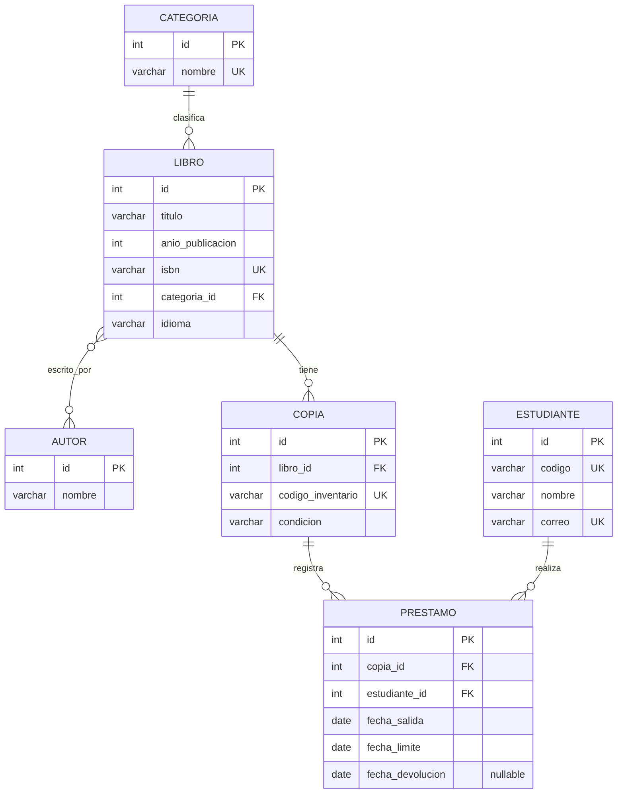

# biblioteca-ufps

## Descripción

Biblioteca UFPS es la base de datos de una biblioteca universitaria construida con Django. Registra libros, autores, categorías, copias físicas, estudiantes y préstamos, y reemplaza el cuaderno en el que la bibliotecaria llevaba los préstamos. Está pensada para el personal de la biblioteca, que la maneja desde el panel de administración de Django sin necesidad de saber programar. El proyecto cubre los modelos, las migraciones, el panel de administración, las consultas con el ORM y su optimización.

## Tecnologías

- Python 3.14.2
- Django 5.2.19
- SQLite

## Instalación y ejecución

```bash
# 1. Clonar el repositorio
git clone [URL DEL REPOSITORIO]
cd biblioteca-ufps

# 2. Crear y activar el entorno virtual
python -m venv venv
source venv/bin/activate        # en Windows: venv\Scripts\activate

# 3. Instalar las dependencias
pip install -r requirements.txt

# 4. Crear la base de datos
python manage.py migrate

# 5. (Opcional) Cargar los datos de prueba
python manage.py loaddata datos_prueba.json

# 6. Crear un superusuario para entrar al panel de administración
python manage.py createsuperuser

# 7. Arrancar el servidor
python manage.py runserver
```

Luego se abre `http://127.0.0.1:8000/admin` y se entra con el superusuario creado en el paso 6. El archivo `db.sqlite3` no se sube al repositorio, por eso cada persona crea su propia base con `migrate`.

Los datos de prueba (`datos_prueba.json`) incluyen 5 libros, 3 autores, 3 categorías, 8 copias, 5 estudiantes y 7 préstamos (algunos devueltos y otros sin devolver).

## Estructura del proyecto

```
biblioteca-ufps/
├── manage.py                                                               # herramienta de línea de comandos de Django (runserver, migrate, shell...)
├── requirements.txt                                                        # librerías que necesita el proyecto
├── datos_prueba.json                                                       # datos de ejemplo para cargar con loaddata
├── .gitignore                                                              # archivos que Git no debe subir (venv, __pycache__, db.sqlite3)
├── config/                                                                 # configuración del proyecto
│   ├── __init__.py                                                         # vacío: marca la carpeta como paquete de Python
│   ├── settings.py                                                         # ajustes: apps instaladas, base de datos, idioma
│   ├── urls.py                                                             # rutas del proyecto (aquí está /admin)
│   ├── wsgi.py                                                             # punto de entrada para servidores web
│   └── asgi.py                                                             # punto de entrada para servidores asíncronos
└── biblioteca/                                                             # la app de la biblioteca
    ├── __init__.py                                                         # vacío: marca la carpeta como paquete de Python
    ├── apps.py                                                             # configuración de la app
    ├── models.py                                                           # los 6 modelos y la regla de la copia prestada
    ├── admin.py                                                            # personalización del panel de administración
    ├── migrations/                                                         # historial de cambios de la base de datos (0001, 0002, 0003)
        ├── __init__.py                                                     # vacío: marca la carpeta como paquete
        ├── 0001_initial.py                                                 # crea las tablas de los modelos
        ├── 0002_libro_idioma.py                                            # agrega el campo idioma a Libro
        └── 0003_alter_prestamo_options_alter_prestamo_copia_and_more.py    # ajustes en prestamo
    ├── views.py                                                            # vacío: el proyecto no tiene vistas propias
    └── tests.py                                                            # vacío
```

## FASE 5. Consultas del ORM

Todas las consultas se ejecutaron en el shell de Django (`python manage.py shell`) con los datos de prueba cargados (`python manage.py loaddata datos_prueba.json`). Al abrir el shell se escribió:

---

### Reto 1. Crear un autor, un libro y dos copias

```python
Autor.objects.create(nombre="Stephen King")
Libro.objects.create(titulo="It", anio_publicacion=1986, isbn="9788466357302", categoria="Terror", autores="Stephen King", idioma="Español")
libro = Libro.objects.get(titulo="It")
libro.autores.add(Autor.objects.get(nombre="Stephen King"))
Copia.objects.create(libro=libro, codigo_inventario="INV-100")
Copia.objects.create(libro=libro, codigo_inventario="INV-101")
```

**Predicción:**

```
<Autor: Stephen King>
<Libro: It (1986)>
<Copia: INV-100 - It>
<Copia: INV-101 - It>
```

**Resultado:**

```
<Autor: Stephen King>
ValueError: Cannot assign "'Terror'": "Libro.categoria" must be a "Categoria" instance.
TypeError: Direct assignment to the forward side of a many-to-many set is prohibited. Use autores.set() instead.
```

**Explicación y ajuste:** Crear el autor funcionó. El primer error vino de pasar el texto `"Terror"` en `categoria`: una `ForeignKey` pide un objeto `Categoria`, así que hay que obtenerlo (o crearlo) antes. El segundo error es porque `autores` es un `ManyToManyField` y no se puede asignar dentro de `create()`: el libro debe existir primero y los autores se agregan después con `add()`. También es más cómodo guardar el autor y el libro en variables. El código correcto es:

```python
Categoria.objects.create(nombre="Terror")   # "Terror" no existía en los datos de prueba
autor = Autor.objects.create(nombre="Stephen King")
libro = Libro.objects.create(titulo="It", anio_publicacion=1986, isbn="9788466357302", categoria=Categoria.objects.get(nombre="Terror"), idioma="Español")
libro.autores.add(autor)
Copia.objects.create(libro=libro, codigo_inventario="INV-100")
Copia.objects.create(libro=libro, codigo_inventario="INV-101")
```

---

### Reto 2. Libros de un autor (buscando al autor por su nombre)

```python
Libro.objects.filter(autores__nombre="Gabriel García Márquez")
```

**Predicción:** Un QuerySet con los libros de Gabriel García Márquez.

**Resultado:**

```
<QuerySet [<Libro: Cien años de soledad (1967)>, <Libro: El amor en los tiempos del cólera (1985)>]>
```

---

### Reto 3. Libros cuyo título contiene una palabra, sin importar mayúsculas

```python
Libro.objects.filter(titulo_contains="amor")
```

**Predicción:** Un QuerySet con los libros que contienen la palabra "amor". En este caso solo hay uno, así que debería mostrar "El amor en los tiempos del cólera".

**Resultado:**

```
django.core.exceptions.FieldError: Cannot resolve keyword 'titulo_contains' into field. Choices are: anio_publicacion, autores, categoria, categoria_id, copia, id, idioma, isbn, titulo
```

**Explicación y ajuste:** Hubo dos errores de escritura. Primero, el separador entre el campo y el modificador es un doble guion bajo (`__`), no uno solo. Segundo, `contains` distingue mayúsculas de minúsculas; como el reto pide ignorarlas, se usa `icontains`. La forma correcta es:

```python
Libro.objects.filter(titulo__icontains="amor")
```

Resultado de la versión corregida:

```
(PEGAR AQUÍ lo que devolvió la versión corregida)
```

---

### Reto 4. Copias físicas disponibles (sin ningún préstamo activo)

```python
Copia.objects.exclude(prestamo__fecha_devolucion__isnull=True)
```

**Predicción:** Debería mostrar las copias sin préstamo activo, incluyendo las creadas en el reto 1.

**Resultado:**

```
<QuerySet [<Copia: INV-004 - Clean Code>, <Copia: INV-005 - El amor en los tiempos del cólera>]>
```

**Explicación y ajuste:** El comando dejó fuera las copias que nunca se han prestado. Al unir las tablas, para una copia sin préstamos la `fecha_devolucion` queda vacía, y Django la trata igual que un préstamo sin devolver, por eso `exclude` la elimina. Solo quedaron las copias que tienen préstamos y ya fueron devueltos. La forma correcta es buscar primero los préstamos activos y excluir las copias que aparecen en ellos:

```python
activos = Prestamo.objects.filter(fecha_devolucion__isnull=True)
Copia.objects.exclude(id__in=activos.values("copia"))
```

```
<QuerySet [<Copia: INV-004 - Clean Code>, <Copia: INV-005 - El amor en los tiempos del cólera>, <Copia: INV-006 - Domain-Driven Design>, <Copia: INV-007 - Domain-Driven Design>, <Copia: INV-008 - Sapiens>, <Copia: INV-100 - It>, <Copia: INV-101 - It>]>
```

---

### Reto 5. Estudiantes con al menos un préstamo activo, sin repetir

**Primer intento:**

```python
Estudiante.objects.filter(prestamo__fecha_devolucion__isnull=True).distinct()
```

**Predicción:** Debería mostrar a Valentina Rojas, Andrés Gómez y Laura Martínez, que son los estudiantes con al menos un préstamo sin devolver.

**Resultado:**

```
<QuerySet [<Estudiante: 1152001 - Laura Martínez>, <Estudiante: 1152003 - Valentina Rojas>, <Estudiante: 1152004 - Andrés Gómez>, <Estudiante: 1152005 - Sofía Ramírez>]>
```

**Explicación y ajuste:** Salió Sofía Ramírez, que nunca ha pedido un préstamo. Es el mismo problema del reto 4: para un estudiante sin préstamos, la `fecha_devolucion` de la unión de tablas queda vacía y la condición `isnull=True` lo deja pasar. Además, el resultado era igual con y sin `.distinct()`, porque ningún estudiante tiene dos préstamos activos a la vez. La forma correcta usa la variable `activos` del reto anterior:

```python
activos = Prestamo.objects.filter(fecha_devolucion__isnull=True)
Estudiante.objects.filter(prestamo__in=activos).distinct()
```

```
<QuerySet [<Estudiante: 1152001 - Laura Martínez>, <Estudiante: 1152003 - Valentina Rojas>, <Estudiante: 1152004 - Andrés Gómez>]>
```

---

### Reto 6. Cantidad de préstamos por estudiante (incluyendo los devueltos)

```python
Estudiante.objects.annotate(total=Count("prestamo"))

# Para imprimir:
for e in Estudiante.objects.annotate(total=Count("prestamo")):
    print(e.nombre, e.total)
```

**Predicción:** El `for` recorre los estudiantes e imprime su nombre y su total de préstamos. Debería salir algo como:

```
Laura Martínez 3
Carlos Pérez 2
Valentina Rojas 1
Andrés Gómez 1
Sofía Ramírez 0
```

**Resultado:** Coincidió con la predicción.

```
Laura Martínez 3
Carlos Pérez 2
Valentina Rojas 1
Andrés Gómez 1
Sofía Ramírez 0
```

La suma de los totales es 7, igual al número de préstamos (`Prestamo.objects.count()`).

---

### Reto 7. Libro más prestado

```python
Libro.objects.annotate(total=Count("copia__prestamo")).order_by("-total")
```

**Predicción:** Debería mostrar el libro "Cien años de soledad", que es el que tiene más préstamos (4).

**Resultado:**

```
<QuerySet [<Libro: Cien años de soledad (1967)>, <Libro: Clean Code (2008)>, <Libro: El amor en los tiempos del cólera (1985)>, <Libro: Domain-Driven Design (2003)>, <Libro: Sapiens (2011)>, <Libro: It (1986)>]>
```

**Explicación y ajuste:** Faltó `.first()`. Sin él, el comando devuelve todos los libros ordenados por número de préstamos, y el primero de la lista ya es "Cien años de soledad". La forma correcta y su resultado son:

```python
Libro.objects.annotate(total=Count("copia__prestamo")).order_by("-total").first()
```

```
<Libro: Cien años de soledad (1967)>
```

---

### Reto 8. Estudiantes que nunca han pedido un préstamo

```python
Estudiante.objects.filter(prestamo__isnull=True)
```

**Predicción:** Debería mostrar a Sofía Ramírez, la única que nunca ha pedido un préstamo.

**Resultado:** Coincidió con la predicción.

```
<QuerySet [<Estudiante: 1152005 - Sofía Ramírez>]>
```

Aquí `prestamo__isnull=True` pregunta si el estudiante no tiene ningún préstamo relacionado, a diferencia de `prestamo__fecha_devolucion__isnull=True` de los retos 4 y 5, que mira la columna `fecha_devolucion`.

---

### Reto 9. Marcar un préstamo como devuelto y comprobarlo

```python
p = Prestamo.objects.filter(fecha_devolucion__isnull=True).first()
p.fecha_devolucion = date.today()
Prestamo.objects.get(pk=p.pk).fecha_devolucion
```

**Predicción:** Al asignar la fecha de hoy a `fecha_devolucion`, el préstamo quedará marcado como devuelto y el último comando debería imprimir la fecha de hoy.

**Resultado:** No imprimió nada (el valor leído de la base de datos era `None`).

**Explicación y ajuste:** Faltó `p.save()` después de asignar la fecha. Asignar un atributo solo cambia el objeto en memoria; con `.save()` se escribe en la base de datos. La forma correcta y su resultado son:

```python
p = Prestamo.objects.filter(fecha_devolucion__isnull=True).first()
p.fecha_devolucion = date.today()
p.save()
Prestamo.objects.get(pk=p.pk).fecha_devolucion
```

```
datetime.date(2026, 11, 22)
```

---

### Reto 10. Borrar un autor y observar qué pasa con sus libros

```python
Autor.objects.get(nombre="Stephen King").delete()
```

**Predicción:** Se eliminará el autor "Stephen King", pero el libro "It" no: simplemente quedará sin autores. Se puede comprobar con los comandos de abajo, que deberían dar `False`, `True` y un QuerySet vacío respectivamente.

**Resultado:**

```
>>> Autor.objects.get(nombre="Stephen King").delete()
(2, {'biblioteca.Libro_autores': 1, 'biblioteca.Autor': 1})
>>> Autor.objects.filter(nombre="Stephen King").exists()
False
>>> Libro.objects.filter(titulo="It").exists()
True
>>> Libro.objects.get(isbn="9788466357302").autores.all()
<QuerySet []>
```

**Explicación:** La relación entre libro y autor es un `ManyToManyField`, que no usa `on_delete` (a diferencia de una `ForeignKey`). Al borrar el autor, Django solo eliminó la fila de la tabla intermedia (`Libro_autores`) que lo unía con "It", además del propio autor; por eso el resultado del `delete()` muestra 2 registros borrados. El libro no depende de un autor en particular, así que se conservó y quedó sin autores.


## FASE 6. Reto final: consultas repetidas

Todas las mediciones se hicieron en el shell de Django con `CaptureQueriesContext`, que cuenta cuántas consultas se ejecutan dentro del bloque `with`. Datos al momento de medir: 7 préstamos y 5 libros.

---

### Caso 1. Préstamos con su estudiante y su libro

**Código original (con el problema):**

```python
from django.db import connection
from django.test.utils import CaptureQueriesContext
from biblioteca.models import Prestamo, Libro

with CaptureQueriesContext(connection) as ctx:
    for p in Prestamo.objects.all():
        print(p.estudiante.nombre, p.copia.libro.titulo)

print(len(ctx), "consultas")
```

**Predicción:** 1 consulta para traer los préstamos, y por cada préstamo una consulta para `p.estudiante`, otra para `p.copia` y otra para `copia.libro`. Es decir, 1 + 3N. Con 7 préstamos: 1 + 3·7 = **22 consultas**.

**Resultado:** `22 consultas`.

**Corrección con `select_related`:**

```python
with CaptureQueriesContext(connection) as ctx:
    for p in Prestamo.objects.select_related("estudiante", "copia__libro"):
        print(p.estudiante.nombre, p.copia.libro.titulo)

print(len(ctx), "consultas")
```

**Predicción:** Una sola consulta con JOIN que trae préstamo, estudiante, copia y libro juntos: **1 consultas**.

**Resultado:** `1 consultas`.

**Explicación:** `estudiante` y `copia` son `ForeignKey`, es decir, cada préstamo apunta a un solo objeto. Por eso `select_related` puede traerlos en la misma consulta con un JOIN, y con `"copia__libro"` encadena el salto de la copia a su libro.

---

### Caso 2. Libros con la lista de sus autores

**Código original (con el problema):**

```python
with CaptureQueriesContext(connection) as ctx:
    for libro in Libro.objects.all():
        print(libro.titulo, [a.nombre for a in libro.autores.all()])

print(len(ctx), "consultas")
```

**Predicción:** 1 consulta para los libros y 1 por cada libro para sus autores: 1 + N. Con 5 libros: **6 consultas**.

**Resultado:** `6 consultas`.

**Corrección con `prefetch_related`:**

```python
with CaptureQueriesContext(connection) as ctx:
    for libro in Libro.objects.prefetch_related("autores"):
        print(libro.titulo, [a.nombre for a in libro.autores.all()])

print(len(ctx), "consultas")
```

**Predicción:** 1 consulta para los libros y 1 para todos los autores de esos libros: **2 consultas**, sin importar cuántos libros haya.

**Resultado:** `2 consultas`.

---

### ¿Por qué `select_related` no sirve para el caso de los libros y sus autores?

`autores` es un `ManyToManyField`: un libro tiene muchos autores y un autor tiene muchos libros. `select_related` resuelve todo con un JOIN, y en una relación de muchos a muchos el JOIN repetiría la fila del libro una vez por cada autor, así que no devuelve un objeto por libro con su lista de autores. `prefetch_related` hace una segunda consulta aparte que trae todos los autores de una vez y los une a cada libro en Python.

---

### Tabla de resultados

| consulta | número de consultas antes | número después |
|---|---|---|
| Préstamos con estudiante y libro | 22 | 1 |
| Libros con sus autores | 6 | 2 |


## Fase 7. El diagrama de relaciones con mermaid



**Correcciones:** 
- No puso "fecha_devolucion" de PRESTAMO como nullable
- El agente incluyo una tabla LIBRO_AUTOR, lo que hacia que el ManyToManyField entre LIBRO y AUTOR no apareciera como muchos a muchos

## Modelo de datos

Las relaciones del diagrama superior son, una por una:

- **Categoría → Libro (uno a muchos):** cada libro pertenece a una sola categoría y una categoría agrupa muchos libros. La `ForeignKey` está en `Libro` con `on_delete=PROTECT`, para no poder borrar una categoría que todavía tenga libros.
- **Libro ↔ Autor (muchos a muchos):** un libro puede tener varios autores y un autor puede haber escrito varios libros. Se declara con un `ManyToManyField` en `Libro`, y Django crea solo la tabla intermedia `biblioteca_libro_autores`.
- **Libro → Copia (uno a muchos):** de un mismo libro puede haber varias copias físicas, cada una con su código de inventario y su condición. Es la razón de que sean dos modelos: con uno solo no se podría saber qué copia concreta está prestada. La `ForeignKey` está en `Copia` con `on_delete=CASCADE`, porque una copia no tiene sentido sin su libro.
- **Copia → Préstamo (uno a muchos):** una copia puede prestarse muchas veces a lo largo del tiempo, pero cada préstamo es de una sola copia. Usa `on_delete=PROTECT` para conservar el historial.
- **Estudiante → Préstamo (uno a muchos):** un estudiante puede tener muchos préstamos y cada préstamo es de un solo estudiante. Usa `on_delete=PROTECT`, así no se puede borrar un estudiante que tenga historial.

La fecha real de devolución (`fecha_devolucion`) admite valores vacíos (`null=True, blank=True`): mientras el libro sigue prestado vale `None`, y esa es la definición de préstamo activo.

### Regla de la copia prestada

"Una copia no puede estar prestada a dos personas al mismo tiempo" se implementó con una **restricción en la base de datos** (`UniqueConstraint` condicional dentro de `class Meta` de `Prestamo`):

```python
models.UniqueConstraint(
    fields=["copia"],
    condition=Q(fecha_devolucion__isnull=True),
    name="una_copia_un_prestamo_activo",
    violation_error_message="Esta copia ya está prestada y no ha sido devuelta.",
)
```

La restricción dice que no puede haber dos préstamos de la misma copia que tengan `fecha_devolucion` vacía. Un préstamo ya devuelto no cuenta, así que la copia se puede volver a prestar.

**Por qué elegimos constraint y no `clean()`:** `clean()` solo se ejecuta cuando los datos vienen de formularios o del admin, y se salta si se guarda con `.save()` o `.create()` desde el shell o desde un script. La restricción la hace cumplir la propia base de datos sin importar desde dónde se guarde, así que la regla no se puede romper por accidente. Además, con `violation_error_message` el admin muestra un mensaje claro a la bibliotecaria.

**Prueba:** al intentar crear un segundo préstamo de una copia que ya está prestada, el admin (y `full_clean()`) muestra el mensaje "Esta copia ya está prestada y no ha sido devuelta.", y desde el shell `Prestamo.objects.create(...)` lanza `IntegrityError: UNIQUE constraint failed`. [CONFIRMAR: que lo probaron ustedes]

## Panel de administración

Se personalizó pensando en una bibliotecaria sin conocimientos técnicos que registra préstamos todos los días:

| Personalización | Necesidad que resuelve |
|---|---|
| `search_fields` de `Estudiante` por código y nombre | Encontrar a un estudiante escribiendo cualquiera de los dos datos. |
| Filtro propio "Estado" en `Prestamo` (Sin devolver / Devueltos) | Ver de un vistazo qué préstamos siguen sin devolverse. |
| Columna "Devuelto" (con ícono de sí/no) en `Prestamo` | Distinguir préstamos activos y devueltos en la lista, sin leer fechas. |
| `autocomplete_fields` en `copia` y `estudiante` de `Prestamo` | Elegir copia y estudiante escribiendo en una caja de búsqueda, en vez de una lista larguísima en la que es fácil confundirse. |
| `search_fields` de `Prestamo` (código del estudiante, nombre y código de inventario) | Buscar un préstamo por estudiante o por copia. |
| Copias como `TabularInline` dentro de `Libro` | Registrar las copias físicas en la misma página del libro. |
| `readonly_fields` con "Total de copias" en `Libro` | Ver cuántas copias tiene el libro sin poder editar el dato por error. |
| `list_display`, `search_fields` y `list_filter` en `Libro`, `Copia` y `Prestamo` | Listas con las columnas útiles, búsqueda y filtros laterales (por categoría, idioma, condición y fecha límite). |
| `__str__` legible en todos los modelos | Que el admin muestre "INV-001 - Clean Code" en vez de "Copia object (1)". |

## Uso de inteligencia artificial

Usamos Chat GPT como apoyo en la fase 7 para el diagrama mermaid. Le pasamos `models.py` y le pedimos un `erDiagram` con todos los modelos, sus campos y las relaciones, usando las instrucciones sugeridas del archivo PDF del ejercicio. El agente no marcó `fecha_devolucion` como opcional y agregó una tabla `LIBRO_AUTOR`, con lo que la relación entre libro y autor no aparecía como muchos a muchos. Lo corregimos a mano (ver correcciones debajo del diagrama).

## Equipo y reflexión

**Integrantes:**

- Juan de Jesús Rincón Rondón
- Yelitz Saray Florez Ortiz
- Karol Zulay Solano Gómez

**1. ¿Qué parte de su diseño cambió después de escribir las primeras consultas, y por qué?**

La estructura de los modelos no cambió: las consultas confirmaron que el diseño permitía responder todas las preguntas de los diez retos. Lo que sí descubrimos al consultar fue que "copia disponible" no es un campo guardado, sino algo que se calcula a partir de los préstamos activos (los que no tienen fecha de devolución), y que por eso los retos 4 y 5 necesitaron una subconsulta (`activos`) en vez de un simple filtro sobre la copia o el estudiante.

**2. ¿En qué se equivocó el agente con el diagrama y cómo lo notaron?**

El agente incluyó una tabla `LIBRO_AUTOR` que no existe en `models.py`, así que la relación entre libro y autor no se veía como muchos a muchos, y no marcó `fecha_devolucion` como campo opcional. Lo notamos comparando el diagrama contra el código modelo por modelo: en `models.py` la relación es un solo `ManyToManyField` (la tabla intermedia la crea Django por su cuenta) y `fecha_devolucion` tiene `null=True, blank=True`.

**3. ¿Qué decisión de su modelo defenderían ante otro grupo y cuál cambiarían si empezaran de nuevo?**

Defenderíamos separar `Libro` y `Copia`: así se sabe exactamente qué copia está prestada y a quién, y se puede tener varias copias del mismo libro en distinto estado. También defenderíamos haber puesto la regla de la copia prestada como restricción en la base de datos, porque no depende de por dónde se guarde el dato, y el uso de `PROTECT` en los préstamos para conservar el historial.

Cambiaríamos hacer único el nombre del autor, porque ahora se puede crear dos veces a "Stephen King" sin ningún error, y agregar una validación de que `fecha_limite` no sea anterior a `fecha_salida`, que hoy el modelo no revisa.
